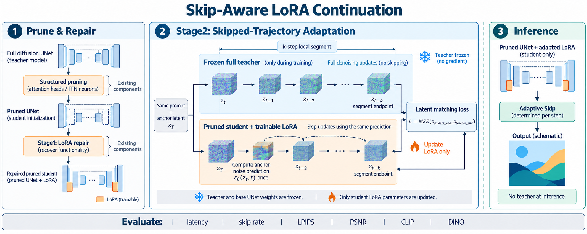
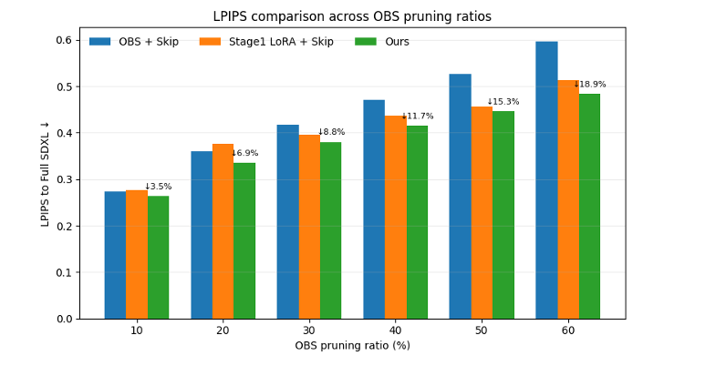
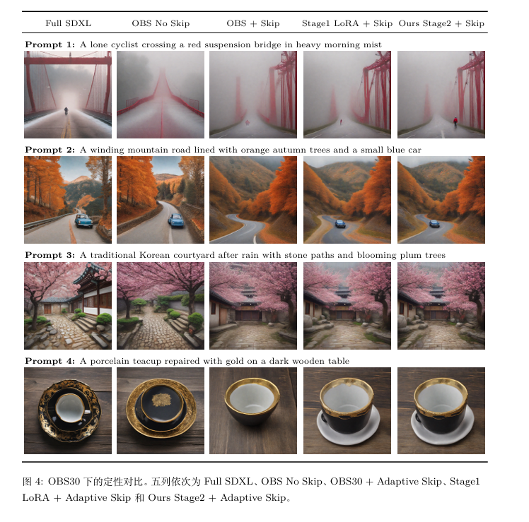
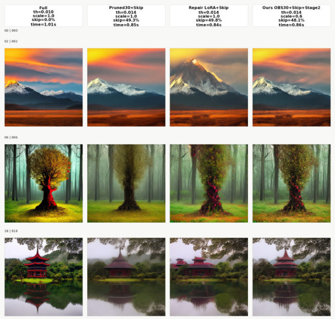
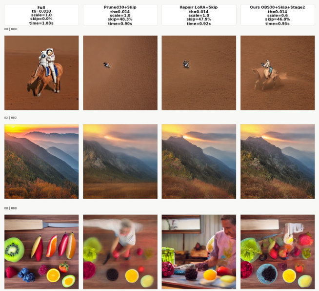

# Skip-Aware LoRA Continuation

**技术报告：[Skip-Aware LoRA Continuation for Pruned Diffusion Models（PDF）](paper/skip_aware_lora_continuation.pdf)**

**面向剪枝扩散模型的跳步感知 LoRA 续训练**

SDXL 主实验 · OBS 10%–60% · 轨迹级蒸馏 · SD1.5 / SD2.1 补充定性结果

[方法说明](docs/METHOD.md) · [环境与使用](USAGE.md) · [实验与图表来源](docs/EXPERIMENTS.md) · [上游致谢](THIRD_PARTY.md)

> 本项目是基于现有研究代码开展的实验性研究，包含模型剪枝、推理跳步、LoRA 修复与效果评测。项目结果来自已有实验记录，并非完整可复现的论文基准；部分原始模型和环境未保留。

## 项目背景

Stable Diffusion XL（SDXL）生成图片时，需要多次运行去噪网络，推理开销较高。本项目探索把模型结构化剪枝和自适应跳步结合起来，并通过 LoRA 微调缓解加速后与原始模型之间的输出差异。

项目基于已有方法开展研究：使用 OBS-Diff 进行结构化剪枝，结合 AdaptiveDiffusion 的自适应跳步思路，并参考 EcoDiff 的剪枝后 LoRA 修复流程。我们在此基础上实验了两阶段 LoRA 训练：先进行剪枝模型修复，再进行跳步感知续训练。

## 方法流程

方法图为 AI 辅助绘制的概念示意，不是实验输出。准确的训练逻辑、符号定义和损失见[方法说明](docs/METHOD.md)。图中的时间下标表示局部更新位置，不是 DDIM 调度器的实际数值时间戳。

1. **结构化剪枝**：使用 OBS-Diff 对 SDXL 的部分注意力和前馈模块进行剪枝，得到不同剪枝比例的模型。
2. **Stage 1：剪枝后修复**：在剪枝模型上训练 LoRA，减轻剪枝带来的输出偏差。部分实验采用参考 EcoDiff 的图像微调方式，其他比例的实验记录为教师引导的修复；不同实验不能简单视为相同配置。
3. **Stage 2：跳步感知续训练**：以完整 SDXL 为教师，构建跳步轨迹，并继续训练学生模型的 LoRA，使跳步后的潜变量接近教师轨迹。最终一组实验使用潜变量误差作为训练目标。
4. **推理与评测**：采用自适应跳步，在不同剪枝比例下生成图片，记录推理时间、跳步率，并与完整 SDXL 生成图进行配对比较。

LoRA 在本项目中主要用于质量修复；推理加速来自剪枝和跳步组合，不能将全部加速归因于 LoRA 或 Stage 2。

## 实验设置与结果

主要实验使用 SDXL、35 个推理步、1024×1024 图片以及 100 条评测 prompt；训练阶段部分实验使用 512×512。对于 OBS 20%、30%、40% 的普通续训对照，记录了相近跳步率下的结果：

| 剪枝比例 | 对照方法 | 平均 LPIPS ↓ | 平均 PSNR ↑ | 平均时间 |
|---|---|---:|---:|---:|
| 20% | 普通续训 500 步 | 0.3497 | 19.63 | 2.72 秒 |
| 20% | 跳步感知续训 | 0.3348 | 19.73 | 2.73 秒 |
| 30% | 普通续训 500 步 | 0.3834 | 18.82 | 2.73 秒 |
| 30% | 跳步感知续训 | 0.3802 | 18.88 | 2.73 秒 |
| 40% | 普通续训 500 步 | 0.4240 | 18.28 | 2.73 秒 |
| 40% | 跳步感知续训 | 0.4152 | 18.33 | 2.75 秒 |

表中 LPIPS 和 PSNR 衡量与对应 Full SDXL 参考图的差异，并不等同于人类主观画质。结果说明本次实验中的跳步感知续训在这些配对指标上有一定改善，但不同指标和图片的表现不完全一致，也不能据此声称方法普遍优于普通续训。

图中百分比表示相对于 OBS + Skip 的 LPIPS 降幅。Stage1 和 Stage2 使用的推理 LoRA scale 分别为 1.0 和 0.6，且不同剪枝比例的训练配置不完全一致，因此这张图不是严格控制变量的消融对比。LPIPS 越低仅表示与 Full SDXL 参考图的感知距离更小，不代表所有维度的画质都更好。

## 生成图片示例

下图为 OBS 30% 剪枝下的定性对比，从左到右依次为 Full SDXL、OBS 不跳步、OBS + Skip、Stage1 LoRA + Skip、Stage2 + Skip。图片仅展示部分提示词，不能单独代表整体效果。

## 跨模型补充展示

论文附录还提供 SD1.5、SD2.1 的定性对比。下列图片直接提取自最新版论文中的 Figure A.10 和 A.13，均为 OBS30；四列分别为 Full、Pruned + Skip、Repair LoRA + Skip、Stage2 + Skip。这里只展示初步定性结果，不声称已完成跨模型定量泛化验证；对应模型训练代码尚未包含在本仓库。

### SD2.1 · OBS30

### SD1.5 · OBS30

图表来源与实验边界见[实验说明](docs/EXPERIMENTS.md)。

## 实验局限与复现范围

- 部分训练 prompt 与评测 prompt 重叠，评测结果不能视为完全独立测试集上的泛化结果。
- 不同剪枝比例的训练样本数和 Stage 1 实现并不完全一致；部分权重与训练摘要的对应关系尚未完全核实。
- OBS 30%、40% 普通续训与跳步感知续训的训练 prompt 数量不同，因此续训消融不是严格的同数据量比较。
- 实验设备、原始剪枝模型和完整运行环境未全部保留。时间数据依赖硬件和具体配置，不应直接视为其他设备上的性能保证。
- FID 实验中出现灰图异常，相关结果未纳入本项目展示。

## 代码与来源

准备公开时应只放经过整理和审查的必要训练、推理和指标代码，去除个人路径、服务器信息、敏感数据和不具备分发许可的权重。引用并保留上游项目的版权和许可证信息：

- [OBS-Diff](https://github.com/Alrightlone/OBS-Diff)
- [AdaptiveDiffusion](https://github.com/UniModal4Reasoning/AdaptiveDiffusion)
- [EcoDiff](https://github.com/YaNgZhAnG-V5/EcoDiff)

本地候选目录的文件说明及使用限制见 [USAGE.md](USAGE.md)，上游来源与授权检查见 [THIRD_PARTY.md](THIRD_PARTY.md)，实验汇总见 [results/continuation_comparison.csv](results/continuation_comparison.csv)。
